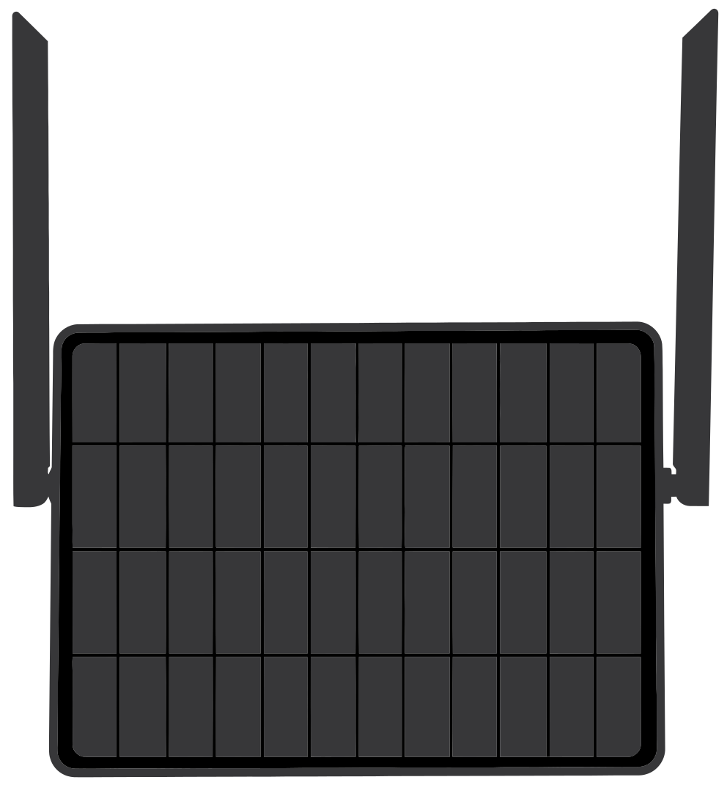

# Elecrow ThinkNode M6

Solar repeater by Elecrow.

## Official contacts

* Manufacturer: [Elecrow](https://www.elecrow.com/thinknode-m6-outdoor-solar-power-for-lora-powered-by-nrf52840-supports-gps.html)
* Initial port: fdlamotte
* Official maintainer: Bensay95

## Features support

| Category | Feature | Meshcore support | Notes |
| --- | --- | --- | --- |
| **CPU** | nRF52840 | ✅ | |
|| SPI Flash | ? ||
|| RTC, PCF | ✅ ||
| **Radio** | sx1262 | ✅ | |
|| max TX : 22dBm |||
| **Connectivity**||||
|| BLE | ✅ ||
|| Serial | ✅ ||
| **UI** ||||
|| Button | Not yet ||
|| Blue led | status led ||
|| Red led | tx led ||
| **Power** ||||
|| 7000mAh battery |||
|| 6W Solar Panel |||
| **GPS** | L76K | ✅ ||
| **Sensors** ||||
|| None |||

## Official roles

* Repeater role [flasher](https://flasher.meshcore.io/elecrow-thinknode-m6/repeater/v1.17.1)

## Discussions

[Related issues](https://github.com/meshcore-dev/meshcore/issues?q=is%3Aissue+state%3Aopen+m6)
